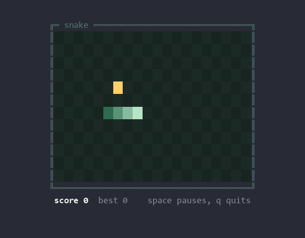

<p align="center">
  
</p>

<p align="center">
  A terminal UI library for <a href="https://codeberg.org/seal-lang/seal">Seal</a>, written in Seal.
</p>

<p align="center">
  <a href="https://github.com/Huseynteymurzade28/suitui/actions"></a>
</p>

<p align="center">
  
</p>

## Try it

```
git clone --recursive https://github.com/Huseynteymurzade28/suitui
cd suitui
make run EX=09
```

<details>
<summary>All examples</summary>

| `EX=` | example |
|---|---|
| `01` | hello box |
| `02` | key viewer |
| `03` | colors and styles |
| `04` | paint |
| `05` | the banner above |
| `06` | walk an `@` around, only changed cells get redrawn |
| `07` | a box that stays centered while you resize the window |
| `08` | border styles |
| `09` | snake |
| `10` | Turkish, CJK and emoji lined up in a table |
| `11` | Label and Box widgets |
| `12` | a scrolling list of seals |

</details>

## Drawing

```
include "tui"

Tui.init()
Tui.box(2, 1, 30, 5, "hello")
Tui.move(10, 3)
Tui.fg("#ff8fab")
Tui.write("Hello, Seal")
Tui.reset()

key = Tui.readkey()
Tui.quit()
print("you pressed", key)
```

- **Keys** come back as names: `up`, `ctrl+right`, `shift+tab`, `alt+x`, `ç`, and `resize` when the window changes size.
- **Colors** are names (`"red"`, `"bright_blue"`), 0-255, `"#rrggbb"` or `[r, g, b]`.
- **Borders** are `single`, `rounded`, `double` or `thick`, picked with `Tui.border(name)`.
- **Wide characters** (CJK, emoji) take two cells, `Tui.width(s)` tells how many columns a string needs.
- **Only changed cells** are sent to the terminal on each frame.

## Widgets

A widget is a map with a `draw(x, y, w, h)` function, it paints itself into the rectangle it is given.

```
list = ListView.new(["one", "two", "three"])
box = Box.new("pick one", list)
box->draw(0, 0, Tui.w, Tui.h)
list->key(Tui.readkey())
```

| widget | |
|---|---|
| `Label` | text, aligned left, center or right |
| `Box` | a border and a title around another widget |
| `ListView` | a scrolling list with a selected item |

<p align="center">
  
</p>

## How it's built

Everything is Seal except `termio.so`, a small C module for what Seal can't do on its own yet:
raw mode, reading a byte with a timeout and the terminal size. The
[upstream](https://github.com/Huseynteymurzade28/suitui/labels/upstream) issues track what Seal
would need for that module to go away.

Early, changes every day. The plan lives in the
[roadmap](https://github.com/Huseynteymurzade28/suitui/labels/roadmap) issues.
