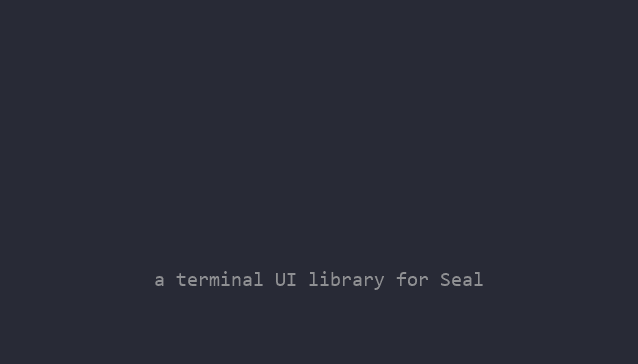
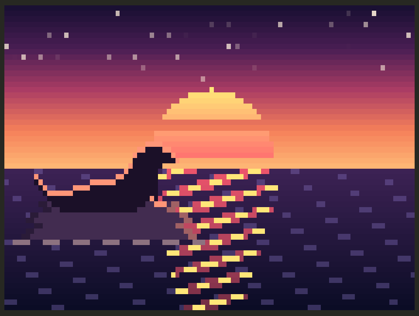
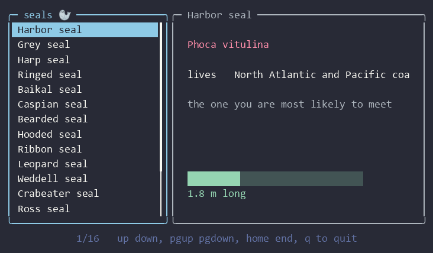
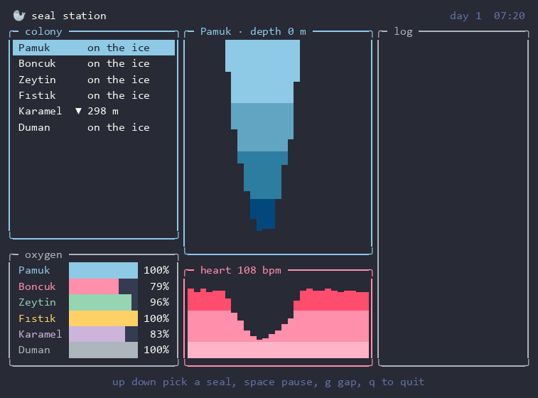
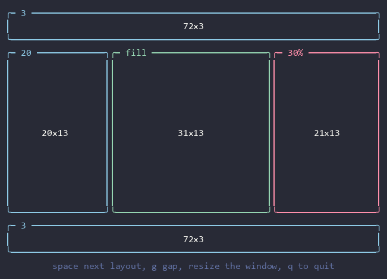
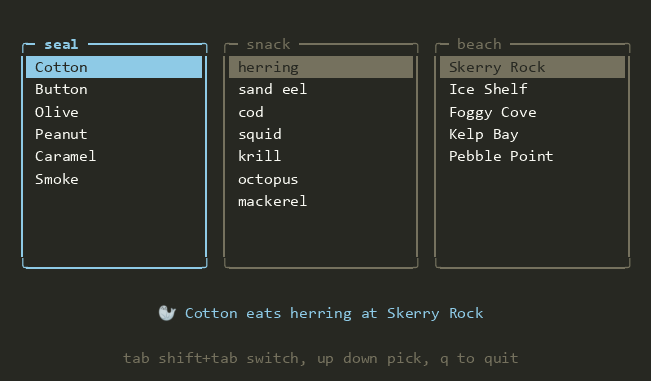
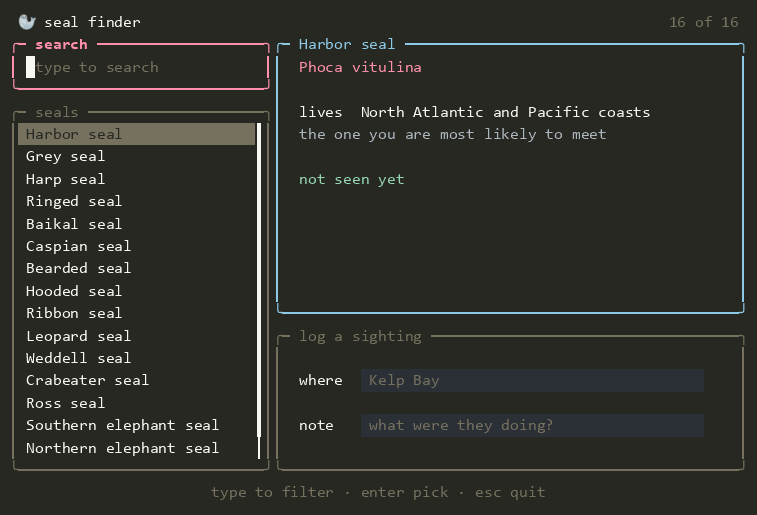
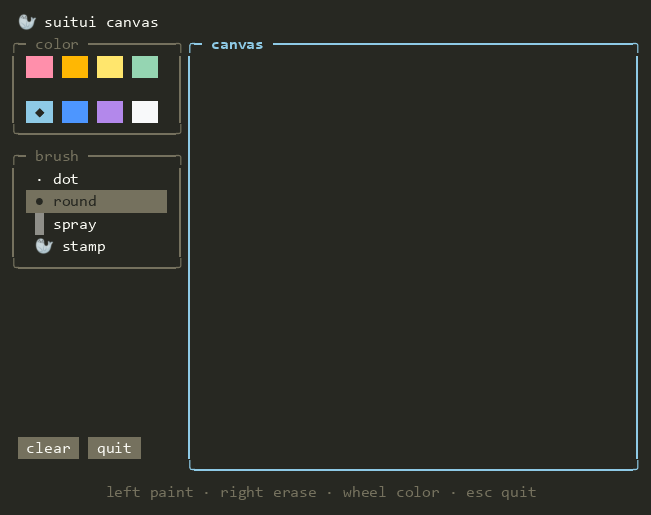
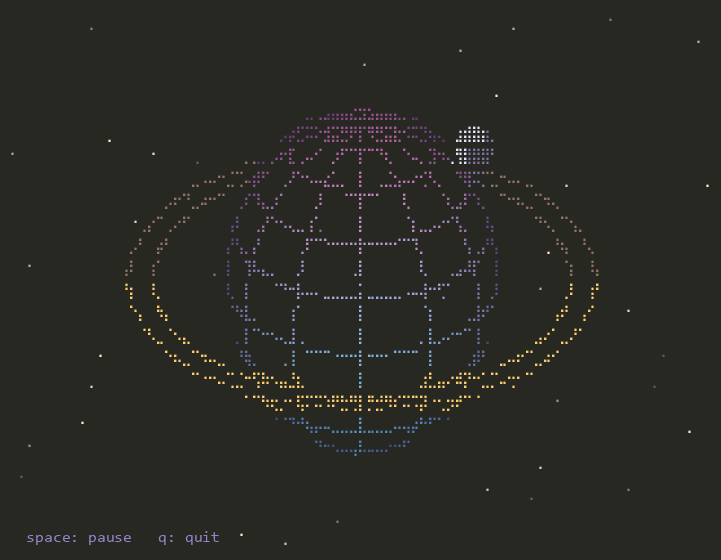
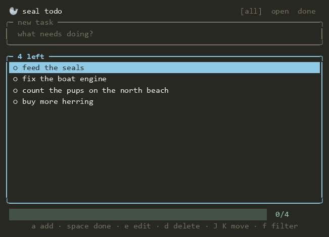

<p align="center">
  
</p>

<p align="center">
  A terminal UI library for <a href="https://codeberg.org/seal-lang/seal">Seal</a>, written in Seal.
</p>

<p align="center">
  <a href="https://github.com/Huseynteymurzade28/suitui/actions"></a>
</p>

<p align="center">
  
</p>

## Try it

```
git clone --recursive https://github.com/Huseynteymurzade28/suitui
cd suitui
make run EX=09
```

<details>
<summary>All examples</summary>

| `EX=` | example |
|---|---|
| `01` | hello box |
| `02` | key viewer |
| `03` | colors and styles |
| `04` | paint |
| `05` | the banner above |
| `06` | walk an `@` around, only changed cells get redrawn |
| `07` | a box that stays centered while you resize the window |
| `08` | border styles |
| `09` | snake |
| `10` | Turkish, CJK and emoji lined up in a table |
| `11` | Label and Box widgets |
| `12` | a scrolling list of seals |
| `13` | rows and columns that follow the window |
| `14` | a seal station, charts and a log laid out with rows and columns |
| `15` | three lists, tab moves between them |
| `16` | seal finder: search as you type, log a sighting with a small form |
| `17` | paint with the mouse: brushes, a palette, seal stamps |
| `18` | seal todo: add, check off, edit and reorder tasks, kept in `~/.seal_todo` |
| `19` | a seal watching the sunset, every cell is two pixels |
| `20` | a ringed planet with a moon, drawn with braille dots |

</details>

## Drawing

```
include "tui"

Tui.init()
Tui.box(2, 1, 30, 5, "hello")
Tui.move(10, 3)
Tui.fg("#ff8fab")
Tui.write("Hello, Seal")
Tui.reset()

key = Tui.readkey()
Tui.quit()
print("you pressed", key)
```

- **Keys** come back as names: `up`, `ctrl+right`, `shift+tab`, `alt+x`, `ç`, `click`, and `resize` when the window changes size.
- **Colors** are names (`"red"`, `"bright_blue"`), 0-255, `"#rrggbb"` or `[r, g, b]`.
- **Borders** are `single`, `rounded`, `double` or `thick`, picked with `Tui.border(name)`.
- **Wide characters** (CJK, emoji) take two cells, `Tui.width(s)` tells how many columns a string needs.
- **Only changed cells** are sent to the terminal on each frame.

<p align="center">
  
</p>

## Widgets

A widget is a map with a `draw(x, y, w, h)` function, it paints itself into the rectangle it is given.

```
list = ListView.new(["one", "two", "three"])
box = Box.new("pick one", list)
box->draw(0, 0, Tui.w, Tui.h)
list->key(Tui.readkey())
```

| widget | |
|---|---|
| `Label` | text, aligned left, center or right |
| `Box` | a border and a title around another widget |
| `ListView` | a scrolling list with a selected item |
| `TextInput` | one line of text with a cursor, scrolls when it gets long |
| `Button` | calls a function on enter, space or a click |

<p align="center">
  
</p>

## Layout

<p align="center">
  
</p>

`Row` puts widgets side by side, `Col` stacks them. Each part is a widget and a size:
a number of cells, a percentage, or `"fill"` for a share of whatever is left.

```
body = Row.new([[sidebar, 20], [main, "fill"], [preview, "30%"]])
root = Col.new([[header, 3], [body, "fill"], [status, 1]])
root->draw(0, 0, Tui.w, Tui.h)
```

Rows and columns are widgets too, so they nest. `null` in place of a widget leaves the space empty,
`row.gap = 1` puts a cell between the parts.

<p align="center">
  
</p>

## Focus

`Focus` holds the widgets that take keys. Tab and Shift+Tab move between them, every other key goes
to the focused one. A `Box` with `hi` set lights up in that color while its child has focus.

```
focus = Focus.new([seals, snacks, beaches])
focus->key(Tui.readkey())
```

<p align="center">
  
</p>

## Text input

```
search = TextInput.new("type to search")
if search->key(Tui.readkey()) then print(search.text)
```

Left and right, home and end, Ctrl+Left and Ctrl+Right jump over words, Ctrl+W deletes one,
Ctrl+U clears everything before the cursor. `key` returns true when the text or the cursor moved.

<p align="center">
  
</p>

## Mouse

```
Tui.track("click")
key = Tui.readkey()
if key == "click" then print(Tui.mouse.x, Tui.mouse.y)
```

Clicks come in as keys too: `click`, `rightclick`, `middleclick`, `release`, `drag`, `wheelup`,
`wheeldown`, with `ctrl+`, `alt+` and `shift+` in front when held. `Tui.mouse` has the position.
`Tui.track("move")` also sends `move` when nothing is pressed, `"off"` stops it.

`Focus` hands clicks to the widget under the pointer and focuses it. Lists select what you click and
scroll with the wheel or by dragging the scrollbar, a text input moves its cursor to the click.

```
save = Button.new("save", define() print("saved"))
focus = Focus.new([list, input, save])
```

<p align="center">
  
</p>

## Pixels

`Pixels` is a grid of colors, two per cell: the top one is drawn with `▀`, the bottom one is its background.
An 80x24 terminal becomes an 80x48 picture. Colors are `"#rrggbb"`, `[r, g, b]` or 0-255, `null` is see-through.

```
p = Pixels.new(Tui.w, Tui.h * 2)
p->set(10, 7, "#ffd66b")
p->fill(null)
p->draw(0, 0, Tui.w, Tui.h)
```

## Dots

`Dots` draws with braille characters, every cell holds 2x4 dots, so an 80x24 terminal becomes 160x96.
Fine enough for lines, curves and wireframes. Each cell has one color, the last dot set in it picks it.

```
d = Dots.new(Tui.w * 2, Tui.h * 4)
d->line(0, 0, 40, 30, "#ffcd6e")
d->set(80, 48, [90, 220, 255])
d->draw(0, 0, Tui.w, Tui.h)
```

<p align="center">
  
</p>

## A real app

`examples/18_todo.seal` puts it all together in about 200 lines: a text input, a list, a focus ring,
mouse clicks on the checkboxes and a progress bar, saved to `~/.seal_todo` (or `$TODO_FILE`) after every change.
`list.paint` styles a single row, here it greys out and strikes through what's done:

```
list.paint = define(self, at)
    if TASKS[at].done then Tui.attr("strike")
```

<p align="center">
  
</p>

## How it's built

Everything is Seal except `termio.so`, a small C module for what Seal can't do on its own yet:
raw mode, reading a byte with a timeout and the terminal size. The
[upstream](https://github.com/Huseynteymurzade28/suitui/labels/upstream) issues track what Seal
would need for that module to go away.

Early, changes every day. The plan lives in the
[roadmap](https://github.com/Huseynteymurzade28/suitui/labels/roadmap) issues.
