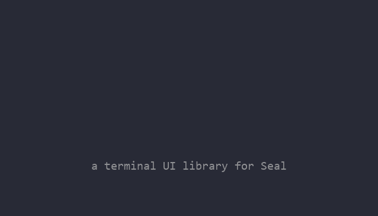
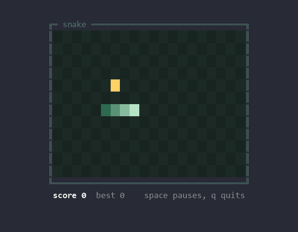
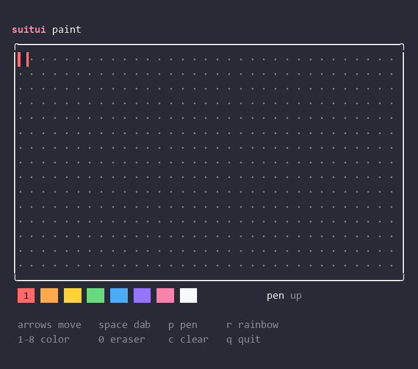
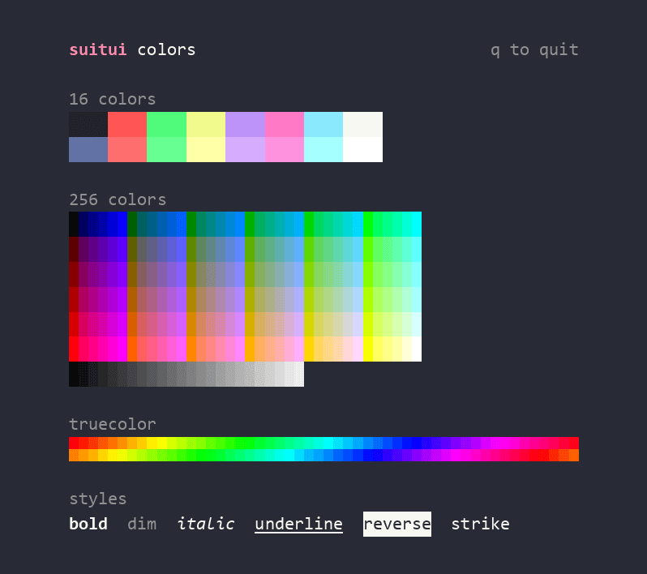

<p align="center">
  
</p>

<p align="center">
  A terminal UI library for <a href="https://codeberg.org/seal-lang/seal">Seal</a>, written in Seal.
</p>

<p align="center">
  <a href="https://github.com/Huseynteymurzade28/suitui/actions"></a>
</p>

---

<p align="center">
  
</p>

<p align="center">
  
  
</p>

## Try it

```
git clone --recursive https://github.com/Huseynteymurzade28/suitui
cd suitui
make run EX=09
```

| `EX=` | example |
|---|---|
| `01` | hello box |
| `02` | key viewer |
| `03` | colors and styles |
| `04` | paint |
| `05` | the banner above |
| `06` | walk an `@` around, only changed cells get redrawn |
| `07` | a box that stays centered while you resize the window |
| `08` | border styles |
| `09` | snake |

Run them from the repo root.

## A taste

```
include "tui"

Tui.init()
Tui.box(2, 1, 30, 5, "hello")
Tui.move(10, 3)
Tui.fg("#ff8fab")
Tui.write("Hello, Seal")
Tui.reset()

key = Tui.readkey()
Tui.quit()
print("you pressed", key)
```

`Tui.readkey()` returns names like `up`, `ctrl+right`, `shift+tab`, `alt+x` or `ç`.
It returns `resize` when the window changes size, `Tui.w` and `Tui.h` are already updated by then.
`Tui.border("double")` picks the box style: `single`, `rounded`, `double` or `thick`.
Colors can be names (`"red"`, `"bright_blue"`), 0-255, `"#rrggbb"` or `[r, g, b]`.

## How it's built

Everything is Seal (`tui.seal`, `key.seal`, `color.seal`) except `termio.so`, a small C module
for what Seal can't do on its own yet: raw mode, reading a byte with a timeout and the terminal
size. The issues labeled [upstream](https://github.com/Huseynteymurzade28/suitui/labels/upstream)
track what Seal would need for that module to go away.

## Status

Early, changes every day. The plan lives in the
[roadmap](https://github.com/Huseynteymurzade28/suitui/labels/roadmap) issues.
